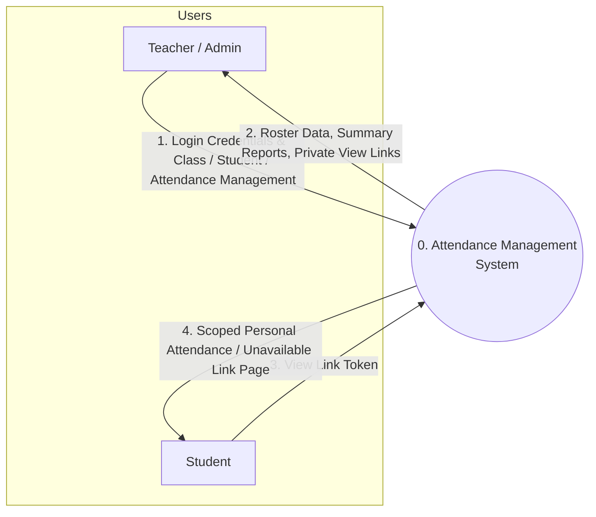
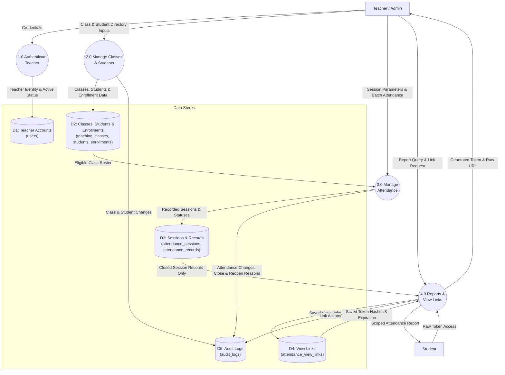
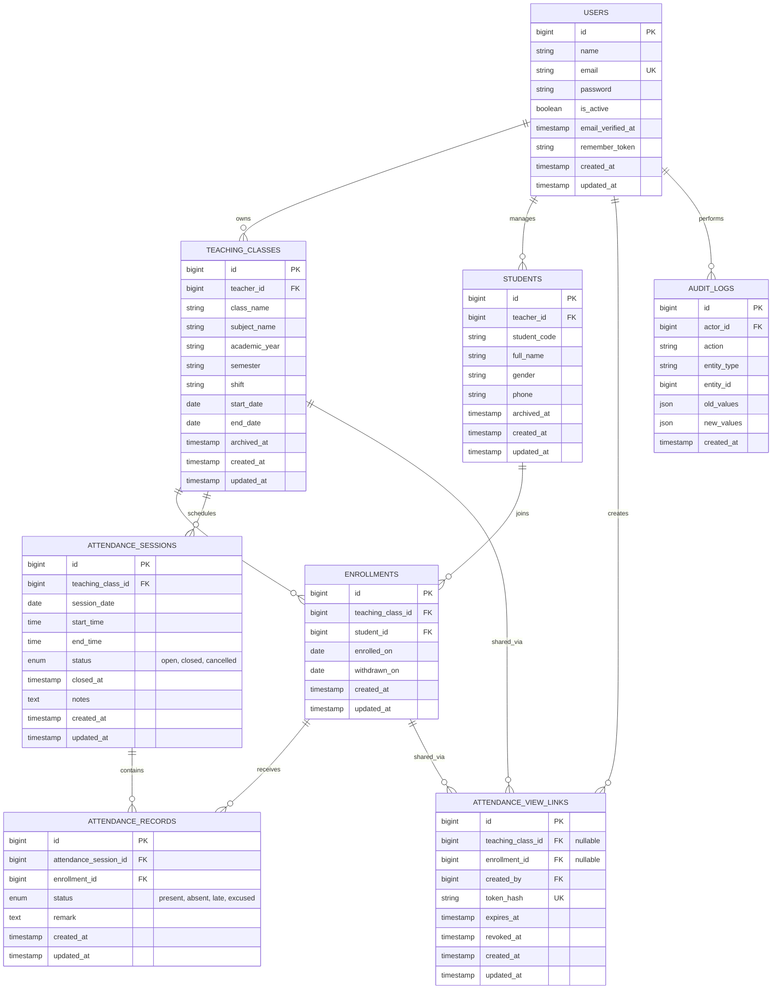

# Student Attendance Management System

A robust, secure, and modern Student Attendance Management System built with **Laravel 13**, **Blade**, **Tailwind CSS**, and **MySQL**, designed specifically for university teachers.

---

## 1. System Overview & Architecture

### Single Authenticated Role: Teacher
- **Admin = Teacher**: There is only one authenticated user type in the application.
- **Single Class Share Link (1 Link for All Students)**: The teacher can generate a single shareable link for each teaching class. All students in the class can open this 1 link to see the whole class attendance board, search their own name, and see their classmates' (friends') attendance — without registering or logging in!
- **Individual Student Private Link (Optional)**: In addition to class-wide links, teachers can also generate private 1-on-1 links scoped exclusively to an individual student.
- **Strict Data Isolation**: Each teacher maintains their own independent classes, student directory, attendance rosters, and reports. Teacher A cannot view, edit, export, or create view links for Teacher B's data under any circumstance.
- **Timezone**: Configured to `Asia/Phnom_Penh` (UTC+7).

---

## 2. System Diagrams

### 2.1 Context Diagram (Level 0 DFD)



### 2.2 Data Flow Diagram (Level 1 DFD)



### 2.3 Entity Relationship Diagram (ERD)



---

## 3. Verified System Requirements

- **PHP**: `8.3.31` or higher (with `pdo_mysql`, `pdo_sqlite`, `openssl`, `mbstring`, `fileinfo`)
- **Laravel Framework**: `13.34.0`
- **Node.js**: `v20.x` or higher
- **MySQL Server**: `8.0` / MariaDB `10.4+` (default port `3306`)

---

## 4. Installation & Setup

### Step 1: Clone and install PHP dependencies
```bash
composer install
```

### Step 2: Configure Environment Variables
Copy `.env.example` to `.env`:
```bash
copy .env.example .env
```
Ensure your MySQL database credentials in `.env` match your local environment:
```ini
DB_CONNECTION=mysql
DB_HOST=127.0.0.1
DB_PORT=3306
DB_DATABASE=attendance_system
DB_USERNAME=root
DB_PASSWORD=123456

APP_TIMEZONE=Asia/Phnom_Penh
```

### Step 3: Generate Application Key
```bash
php artisan key:generate
```

### Step 4: Run Database Migrations
```bash
php artisan migrate
```

---

## 5. Teacher Account Management

### Safe Interactive CLI Command
Create a teacher account safely from the terminal without hardcoding credentials in production:
```bash
php artisan make:teacher
```
You will be prompted interactively for:
- Full Name
- Email address (validated and checked for uniqueness)
- Password (hidden input with confirmation)

To create a teacher directly via CLI options (e.g. in automated setups):
```bash
php artisan make:teacher --name="Dr. Sreymom Doe" --email="sreymom@university.edu" --password="SuperSecurePassword123"
```

### Demo Seeding for Local Development
Seed realistic demonstration classes, students, sessions, records, view links, and multi-tenant isolation fixtures:
```bash
php artisan db:seed
```
*Note: The seeder only runs in `local` and `testing` environments for safety.*

**Seeded Demo Teacher Accounts:**
| Role | Email | Password | Status | Purpose |
| :--- | :--- | :--- | :--- | :--- |
| Primary Teacher | `teacher@example.com` | `password` | Active | Full demo classes & sessions |
| Secondary Teacher | `teacher2@example.com` | `password` | Active | Multi-teacher isolation testing |
| Deactivated Teacher | `inactive@example.com` | `password` | Inactive | Inactive account restriction testing |

---

## 6. Frontend Assets Compilation

Build production bundles using Vite and Tailwind CSS:
```bash
npm run build
```

Run Vite hot-reloading dev server:
```bash
npm run dev
```

---

## 7. Running Automated Tests

Run the full PHPUnit test suite:
```bash
php artisan test
```

The test suite covers:
1. **Authentication & Rate Limiting**: Active teacher login, deactivation blocking, lockout throttling, and logout.
2. **Multi-Teacher Isolation**: Verification that Teacher A cannot view, edit, archive, export, or generate links for Teacher B's records.
3. **Student Directory & CSV Import**: Template download, row-level validation, duplicate rejection, and safe skipping of existing student codes.
4. **Enrollment Rules**: Cross-teacher enrollment rejection, duplicate prevention, and restoration without duplicates.
5. **Attendance Transactions**: Database transactions, row-level locking (`lockForUpdate`), start-time enforcement for scheduled sessions, and session closure prerequisites.
6. **Session Reopening & Cancellation**: Audit logging with mandatory justification reasons.
7. **Reports & Formula Calculation**:
   $$\text{Attendance Rate} = \frac{\text{Present} + \text{Late}}{\text{Present} + \text{Late} + \text{Absent}} \times 100$$
   *Excused sessions are excluded from the denominator.*
8. **Private View Links**: SHA-256 token hashing, single-enrollment scoping, automatic revocation on replacement, absence of student phone numbers / teacher remarks, and HTTP privacy headers (`no-store`, `no-referrer`, `noindex`).

---

## 8. Workflow Guide for Teachers

### 1. Create a Teaching Class
Navigate to **Teaching Classes** &rarr; **Create Class**. Specify class name (e.g. `MIS-Y2-A`), subject, academic year, semester, and semester start/end dates.

### 2. Maintain Student Directory
- Add students individually (**Students** &rarr; **Add Student**) or batch import via **Import CSV**.
- Download the template CSV, review row validation in the **Preview Screen**, and commit clean rows.

### 3. Enroll Students
In the class view, select existing students from your directory to enroll them. If a student withdraws during the semester, click **Withdraw** and provide the effective date. Past closed-session attendance remains preserved.

### 4. Conduct an Attendance Session
1. Click **Schedule Session**, specifying the date and time.
2. Only eligible students actively enrolled on the session date appear on the roster.
3. Use the **Mark All Present** shortcut or toggle individual statuses (`Present`, `Late`, `Absent`, `Excused`) with optional remarks.
4. Click **Save Attendance Records** (committed inside an atomic database transaction).
5. Once all students are marked, click **Close & Lock Session**. Closed sessions become read-only.
6. If an adjustment is necessary later, click **Reopen Session** and provide a reason for the audit trail.

### 5. Generate Attendance Share Links for Students

#### A. Class-Wide Link (1 Link for All Students - Recommended)
1. In the class details page (`/classes/{id}`), locate the prominent **1 Link for All Students** banner.
2. Click **Generate Class Share Link**.
3. A single secure URL is generated (e.g. `/attendance/view/{token}`).
4. Click **Copy Link** and post it in your class group chat (Telegram, Teams, Canvas, etc.).
5. **What students experience:**
   - Any student who opens the link sees the complete class attendance board with live statistics.
   - An instant search bar allows students to quickly type their name or student code to highlight their row.
   - Students can see their friends' and classmates' attendance records transparently.
   - Student privacy is protected: student phone numbers and teacher private remarks are hidden.
   - Only closed sessions are displayed; draft/open sessions remain private.

#### B. Individual Private Links (1-on-1)
1. In the class roster table or student profile, click **Generate Link** next to any specific student.
2. Share the link privately with that student for individual viewing.
3. To replace or revoke any link, click **Replace Link** or **Revoke Link**.

### 6. Reports & CSV Export
Navigate to **Attendance Reports** to filter by class, student, or date range. Export reports directly to CSV (with formula injection protection) or open the printer-friendly **Print View**.

---

## 9. Security & Privacy Guarantees

1. **Token Security**: Tokens are generated using 32 random bytes (`bin2hex(random_bytes(32))`). Only the SHA-256 hash is saved in the database.
2. **Student Privacy**: Public student attendance views never disclose student phone numbers or teacher internal remarks.
3. **No Indexing**: Public view pages serve `X-Robots-Tag: noindex, nofollow`, `Cache-Control: no-store`, and `Referrer-Policy: no-referrer`.
4. **Formula Injection Sanitization**: All exported CSV cells starting with `=`, `+`, `-`, `@`, `\t`, or `\r` are prefixed with `'` to prevent remote command execution in Excel/LibreOffice.
5. **Session Row-Level Locking**: Concurrent attendance modifications and closures are serialized using `lockForUpdate` within database transactions.

---

## 10. Known Limitations & Future Enhancements

- **Single Active Withdrawal Period**: The current version models one active enrollment period per student per class. Multiple interleaved withdraw/re-enrollment cycles within the same academic cohort are reserved for version 2.
- **Manual Link Distribution**: To prevent university server spam classifications, links are copied and shared manually rather than sent via automated email or SMS gateways.
# attendanceSYS
